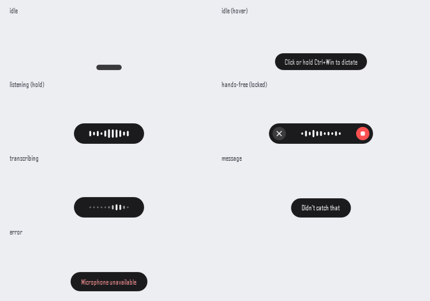
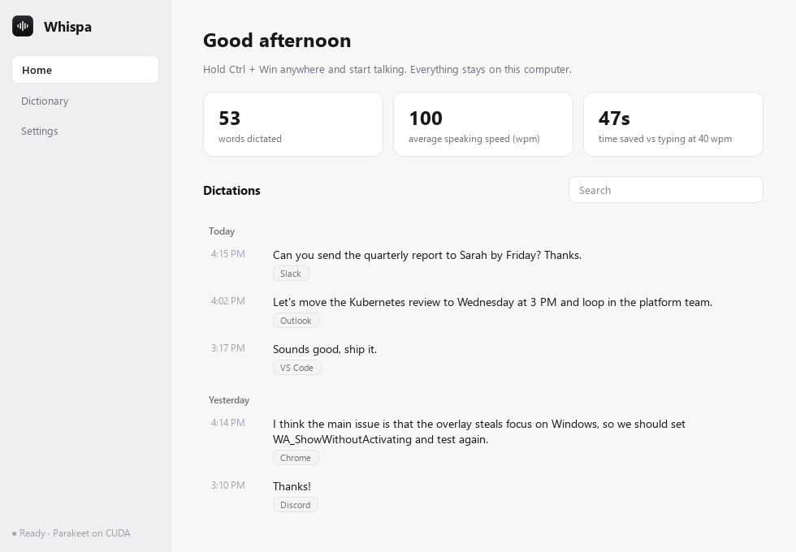
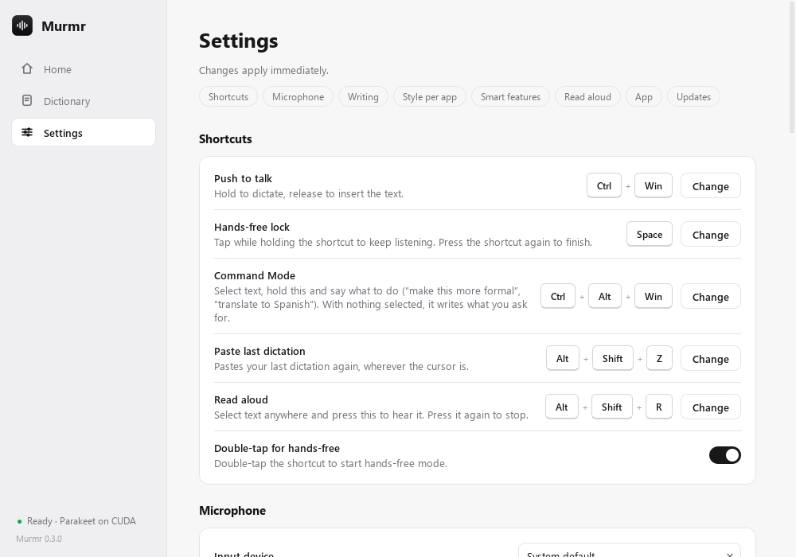
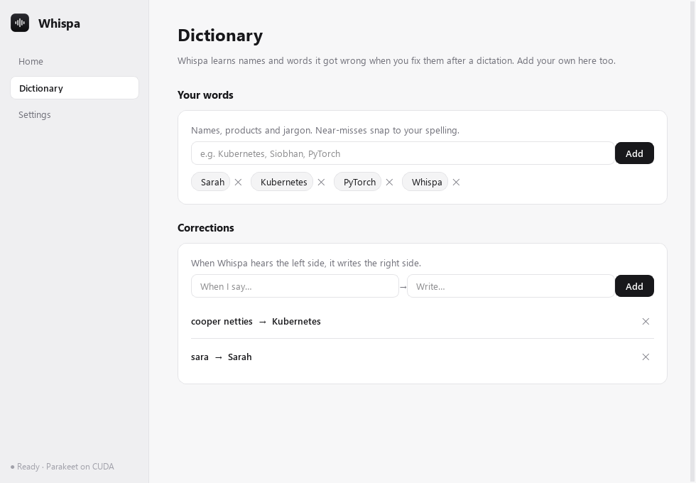
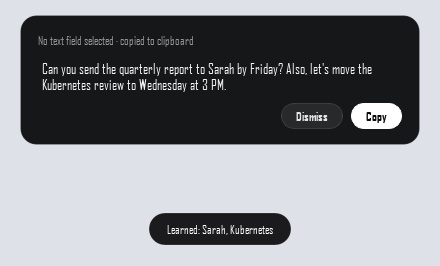

# Murmr

Local push-to-talk dictation for **Windows, macOS and Linux**, in the spirit of Wispr Flow.
Hold a key, talk, let go, and the text appears in whatever app has focus. Speech recognition
runs on your machine with **NVIDIA Parakeet TDT 0.6B v3**; no audio leaves your computer.

The pill at the bottom of your screen while you talk:



The app window (tray icon → Open): your dictations, dictionary and settings.



| Settings | Dictionary |
|---|---|
|  |  |

No text field selected? You get a copy card instead:



Screenshots use sample data. Light and dark mode follow your OS.

**Status:** used daily on Windows 11. The macOS and Linux code paths are written but untested.

## Why Parakeet (research notes, Nov 2026)

| Option | Notes |
|---|---|
| **Parakeet TDT 0.6B v3** (default) | ~6.3% avg WER on the Open ASR Leaderboard (better than Whisper large-v3 at ~7.4%), punctuation and capitalization built in, 25 European languages, CC-BY-4.0. ONNX builds run anywhere through [onnx-asr](https://github.com/istupakov/onnx-asr). |
| Parakeet TDT 0.6B v2 | English only, slightly lower WER (~6.05%). Set `"model": "nemo-parakeet-tdt-0.6b-v2"`. |
| Nemotron-Labs-Unified-ASR 0.6B / Nemotron 3.5 ASR Streaming | NVIDIA's newest models, built for streaming. NeMo/PyTorch only for now (no ONNX build), so not cross-platform yet. Likely future upgrade for live, as-you-speak text. |
| Whisper large-v3-turbo | Works too (`"model": "onnx-community/whisper-large-v3-turbo"`), slower, more languages. |

Measured on this dev box (RTX 3070 Ti / Ryzen 5 5600X), one 6.8 s sentence:
**~45 ms on CUDA**, **~330 ms on CPU (int8)**. Even CPU-only machines feel instant.

## Install

| | Download | |
|---|---|---|
| **Windows 10/11** | [**Murmr-Setup.exe**](https://github.com/FrostyMead/murmr/releases/latest/download/Murmr-Setup.exe) | If Windows says it "protected your PC" (the installer isn't code-signed): **More info → Run anyway** |
| **macOS 11+** | [**Murmr-macOS.dmg**](https://github.com/FrostyMead/murmr/releases/latest/download/Murmr-macOS.dmg) | Open it, double-click **Install Murmr**. First time: System Settings → Privacy & Security → **Open Anyway** |

No admin rights needed. The installer sets up its own Python (via [uv](https://docs.astral.sh/uv/)),
picks GPU or CPU, downloads the newest version that passed the tests and the speech model
(~650 MB), adds Murmr to your apps, turns on launch at login and starts it. The installers are
rebuilt automatically after every change ([release workflow](.github/workflows/release.yml)).

Prefer a terminal? These one-liners do exactly the same:

**Windows** (PowerShell):
```powershell
irm https://raw.githubusercontent.com/FrostyMead/murmr/main/install.ps1 | iex
```

**macOS** (Terminal), installs `~/Applications/Murmr.app`:
```bash
curl -fsSL https://raw.githubusercontent.com/FrostyMead/murmr/main/install.sh | bash
```
Then in System Settings: Keyboard → "Press 🌐 key to" → **Do Nothing**, and under Privacy &
Security allow **Murmr** for Microphone, Input Monitoring and Accessibility. The permissions
belong to Murmr.app (not Terminal) and survive updates.

**Linux**: the same `curl … | bash` line.

Run the installer (or the command) again to repair or reinstall; your settings, dictionary and
history are kept.

**Uninstall:** Windows: Settings → Apps → Murmr → Uninstall. macOS: **Uninstall Murmr** in the
.dmg, or `curl -fsSL https://raw.githubusercontent.com/FrostyMead/murmr/main/uninstall.sh | bash`.
Your settings and history are kept unless you choose to remove everything (`-All` /
`--all`).

*Murmr was called Whispa before; existing installs update and rename themselves, keeping your
data and settings. On the Mac, allow Murmr once more in Privacy & Security after the rename.*

### Updates
Murmr checks GitHub every few hours, downloads a new version in the background and restarts
into it when you've been away for 10 minutes (no typing, nothing being dictated or read, window
closed); the restart takes a few seconds. Afterwards a notification lists **what's new**, also
shown in Settings → Updates. Prefer to choose the moment? Switch off **Install updates
automatically** and use **Update now**. New packages are installed only if the dependency list
changed. You only get versions whose tests passed on Windows and macOS
([CI](.github/workflows/ci.yml)). If an update doesn't start, the next launch goes back to the previous
version automatically, and **Go back to the previous version** does it by hand. Only public code is
downloaded; nothing about you is sent.

Where things live:

| | Windows | macOS |
|---|---|---|
| App (code + Python) | `%LOCALAPPDATA%\Murmr` | `~/Library/Application Support/Murmr/runtime`, `~/Applications/Murmr.app` |
| Your settings, dictionary, history | `%APPDATA%\Murmr` | `~/Library/Application Support/Murmr` |

### Developer setup
Clone the repo and run `install.ps1` (Windows) or `./install.sh` (macOS/Linux) inside it: you get
an editable install in `.venv` with shortcuts pointing at your checkout. Update it with `git pull`;
the in-app updater leaves developer copies alone. `python -m pytest` runs the tests.

## The app

Murmr lives in the system tray. **Click the tray icon** (or launch Murmr again from the Start
Menu) to open the window; closing the window keeps it running in the tray. Right-click the tray
icon for hands-free dictation, recent transcripts, settings, restart and quit.

- **Home**: your dictations grouped by day (search, paste again, copy, delete), plus words
  dictated, speaking speed, time saved compared with typing, and your day streak.
- **Dictionary**: your words and learned corrections. Add or remove entries.
- **Voice training**: read sentences aloud to build a dataset for tuning the speech model to
  your voice (see [Tune the speech model to your voice](#tune-the-speech-model-to-your-voice)).
- **Settings** (changes apply immediately): record a new push-to-talk shortcut or hands-free key
  by pressing it, pick a microphone, filler removal / voice commands, what happens with no text
  field, AI clean-up status, learning, voice samples, launch at login, sounds, idle pill, and
  GPU/CPU.

Launch at login starts Murmr quietly in the tray (`--background`).

The first time Murmr starts, a short **welcome guide** walks through permissions (macOS), the
microphone, trying the shortcut, and optional extras (local AI, launch at login). Settings →
**Welcome guide** shows it again.

### Sync between your computers
Settings → **Sync**: switch it on on both computers, click **Pair a computer** on each, show a
code on one and type it on the other. From then on your Dictionary (words, corrections,
snippets) stays the same on both, and a speech model tuned on the PC is copied to the Mac
(optional; read-aloud voices made from your recordings too, off by default).

- Direct and local: the computers find each other on your network (UDP 47811) and talk over
  TCP 47812. No cloud, no account, nothing leaves your network. Windows asks once whether to
  allow Murmr on private networks.
- Encrypted: pairing agrees a key (X25519, confirmed by the 8-character code); every sync
  proves both sides hold it and encrypts with ChaCha20-Poly1305.
- Merging: an edit on either computer wins over the unchanged side, and deletions carry over.
  It syncs every 10 minutes and shortly after you change the Dictionary, whenever both are on.

## Using it

| Action | Default (Windows / Linux) | Default (macOS) |
|---|---|---|
| Push-to-talk | hold **Ctrl+Win** (Ctrl+Super), release to insert | hold **fn** |
| Backup push-to-talk | off: set a second shortcut in Settings → Shortcuts (works exactly like the first) | same |
| Hands-free | while holding, tap **Space**, or **double-tap** the hotkey. Press the hotkey again to finish | same |
| Cancel | **Esc** | **Esc** |
| Command Mode | select text, hold **Ctrl+Alt+Win** and say what to do | hold **fn+⌃** |
| Paste last dictation | **Alt+Shift+Z** | **⌃⌘V** |
| Read selection aloud (again to stop) | **Alt+Shift+R** | **⌃⌘R** |
| Mouse | click the idle pill to start hands-free. In hands-free, ✕ cancels and ■ finishes | same |
| Move the pill | drag it anywhere; it snaps to the nearest corner or edge centre and remembers the spot (also in Settings → Pill position). On the left/right edge it stands upright | same |

Pressing another key within 0.4 s of the hotkey (e.g. Ctrl+Win+D) counts as an OS shortcut
and silently cancels, so your normal shortcuts keep working.

### Where the text goes
- **Cursor in a text field:** the text is pasted at the cursor. Murmr **never presses Enter**:
  you review and send it yourself. Line breaks never come last, and in `type` mode they're sent as
  Shift+Enter, so chat apps don't send early.
- **No text field focused** (desktop, a file list, a web page you haven't clicked into): a card
  pops up with the text, already on your clipboard, with **Copy** and **Dismiss** buttons. It
  hides after 20 s unless you hover over it.
- **Can't tell** (custom-drawn apps, games): it pastes.

Detection uses UI Automation on Windows and the Accessibility API on macOS. Linux always pastes for now.

### Clean-up and fixing your mistakes
- filler words ("um", "uh", "hmm") removed
- say **"new line"** / **"new paragraph"** for line breaks, **"scratch that"** to drop the last sentence
- your learned dictionary and `replacements` are applied
- **local LLM polish** (automatic once Ollama is installed): handles self-corrections
  ("meet Tuesday, no wait, Wednesday" → "meet Wednesday"), stutters, false starts, grammar,
  misheard words and dictated lists. It uses your vocabulary and the app you're typing in as
  context. The prompt tells it to keep your words, never answer questions, and never add content.
  It needs Ollama:
  ```
  winget install Ollama.Ollama      # macOS: brew install ollama
  ollama pull gemma3:4b             # ~3.3 GB download, ~2.9 GB of GPU memory
  ```
  Murmr picks it up within 2 minutes, with no restart needed. If the LLM is slow or gives a strange
  answer, the plain transcript is used.

  **Only when needed (default).** Most dictations are already clean, so Murmr only sends a
  dictation to the LLM when it looks like it needs help: self-correction phrases ("no wait",
  "I mean", "sorry", "or rather", "make that"...), repeated words or phrases, spoken lists, or long
  run-on dictations (40+ words). Everything else is inserted right away. Choose **Always** or
  **Off** in Settings → AI clean-up.

  If Ollama is installed but its server isn't running, Murmr starts it (hidden). The model is
  loaded as soon as you press the hotkey, so it's ready by the time you stop talking.

  **Model choice** (`scripts/bench_llm.py`: 30 realistic dictations including 5 held-out
  phrasings; RTX 3070 Ti with Parakeet loaded):

  | Model | Pass | Typical | Notes |
  |---|---|---|---|
  | `gemma3:1b` | 15/25 (first version of the benchmark) | ~0.1 s | Swapped numbers ("40K, or rather 45K" → "45K, or rather 40K"). Not recommended. |
  | `llama3.2:3b` | 27/30 | ~0.09 s | Fast, but answered a dictated question ("…capital of France?" → "Paris."). |
  | **`gemma3:4b`** (default) | **29/30** | **0.1–0.4 s** | All self-corrections, stumbles, lists and held-out phrasings right. |

  The one `gemma3:4b` miss is jargon it has never heard ("cooper netties" → Kubernetes), which
  the learned dictionary covers after one fix. Output is checked before it's used: it must reuse
  your words (no answers or additions) and keep most of what you said, unless you took something
  back. Otherwise the plain transcript is used. Compare models yourself:
  `python scripts/bench_llm.py gemma3:4b llama3.2:3b`.

### Command Mode: edit text with your voice
Select text in any app, hold the Command Mode shortcut and say what to do. Murmr reads the
selection, the local AI (Ollama, same model as AI clean-up) rewrites it, and the result replaces
the selection. Ctrl+Z undoes it. While you're giving a command the pill turns violet.

- "make this more professional", "fix the grammar", "make it shorter"
- "turn this into bullet points", "translate to Spanish", "summarize this in one sentence"
- **nothing selected**: it writes what you ask for at the cursor ("write a short reply saying
  I'll be ten minutes late")
- **selected text you can't edit** (a web page): the result appears in the copy card

The selection is read through accessibility (UI Automation / AX) when possible, otherwise copied
with Ctrl/Cmd+C (your clipboard is restored; terminals are skipped because Ctrl+C would
interrupt). Typically 0.3–0.9 s on an RTX 3070 Ti. Command results are marked ✦ in your history.

### Snippets
Dictionary → Snippets: pick a trigger phrase ("my email", "my calendly link", "my sign off") and
the text to insert, which can be several lines. Say the trigger alone or inside a sentence ("send
it to my email") and Murmr inserts the saved text. The AI clean-up never sees or changes
snippet text. Pick phrases you wouldn't say by accident.

### Style per app
Settings → Style per app. Murmr sees which app you're typing into and adjusts:

| Where | Default | What it does |
|---|---|---|
| Chats (Slack, Teams, WhatsApp, Discord, Messages…) | Casual | no full stop at the end of a message |
| Email (Outlook, Mail, Gmail in a browser…) | Formal | proper sentences |
| Code & terminals (VS Code, Cursor, JetBrains, Terminal, Claude Code…) | Exact | your words, the AI clean-up never rewrites them |
| Everything else | Formal | |

"Very casual" also drops capitals at the start of sentences (names, "I" and acronyms stay).
Browser tabs are recognised by their title (Gmail, Slack, WhatsApp Web…).

### Names from the screen
When you start talking, Murmr reads the names in the window you're dictating into (people in
an email thread or chat, code identifiers in an editor) and uses them to spell what you say:
"Kowalcyk" becomes "Kowalczyk" if that's on screen. It's careful: only words the speech model
heard as a name, never a change of case or an ordinary word. It takes at most 0.4 s in the
background while you speak, the text never leaves this computer and isn't saved. In browsers
it only uses the tab title (walking a web page makes the browser do extra work).

### Paste again
Press **Alt+Shift+Z** (macOS: **⌃⌘V**) to paste your last dictation again, or hover a dictation
on Home and click **Paste** to put it into the app you were using.

### Read aloud
Select text anywhere and press **Alt+Shift+R** (macOS: **⌃⌘R**) to hear it; press it again to
stop. The voice is [Kokoro-82M](https://huggingface.co/hexgrad/Kokoro-82M), running locally:
on an NVIDIA GPU the full model (310 MB, about 15× faster than real time), otherwise an int8
model (88 MB) on a few CPU threads. Pronunciation comes from espeak-ng. It downloads on first
use (the first time it reads with the system voice while that happens) and unloads after 3 idle
minutes so it doesn't keep memory. Pick a voice (American or British) and speed in Settings →
Read aloud, or "System voice" for the OS voice (no download).

While it reads, the pill turns blue and shows **pause/play**, **skip to the next sentence** and
**stop**. Starting a dictation stops the reading, so the mic doesn't hear it.

### Smart formatting
Spoken forms come out written, without the AI: "john dot smith at gmail dot com" →
john.smith@gmail.com, "whispa dot io slash docs" → whispa.io/docs, "20 dollars" → $20,
"10 euros and 50 cents" → €10.50, "50 percent" → 50%, "330 pm" → 3:30 pm. Say **"bullet
point"** before each item to make a list. Each rule needs a clear shape (a real domain ending, a
number next to the unit), so "the dot com bubble" or "lost 5 pounds" stay as they are. Settings →
Writing → Smart formatting.

### Meeting notes and live captions
**Meetings** in the sidebar (or the tray menu): **Start meeting notes** when a call begins.
Murmr transcribes your microphone as **You** and the computer's audio (the other people in
Teams, Zoom or Meet) as **Others**, live, then **Stop and summarize** has the local AI write
a summary with decisions and a checklist of action items. Meetings are saved on this computer
(text only; no audio is kept) and can be copied or exported as Markdown.

- **Who's talking:** voices on the call (or in the room, with only a mic) are told apart
  as Person 1, Person 2, ..., with WeSpeaker voiceprints (a 26 MB local model). Click a name
  in the transcript to name that person; it changes in every line and in the summary, and
  giving two labels the same name merges them. With only a mic, your own voice is recognised
  as "You" from your recordings. Voiceprints exist only during the meeting, unless you switch
  on **Remember voices of people I name**: then, for each person who agreed (Murmr asks), a
  voiceprint (no audio) is kept in `people.json` so later meetings name them. See PRIVACY.md.
- **Live captions:** a floating bar with what's being said right now, for any audio. On its
  own it saves nothing; during meeting notes it shows the meeting.
- **Light on the computer:** lines become final at pauses and their audio is dropped; the
  live text updates every ~1.5 s, slower when transcription is busy (CPU-only Macs).
- **Echo:** if your mic picks up the other people through your speakers, those copies are
  dropped (headphones avoid it entirely).
- **Computer audio** works on Windows (WASAPI loopback) and macOS 13+ (ScreenCaptureKit, via
  the small `murmr-audiotap` helper built from `mac/audiotap.swift`). macOS asks once for
  **Screen & System Audio Recording**: Murmr only takes the sound, never the screen, and its
  own sounds (read aloud) are left out.
- Summaries need the local AI (Ollama + gemma3:4b). Long meetings are summarized in parts.
- Let everyone know you're taking notes: in some places transcribing a conversation needs
  everyone's consent.

### Long dictations
For dictations longer than about 20 s, Murmr transcribes while you're still talking: it cuts
the audio at a pause and works on that piece in the background, so letting go only waits for
the last few seconds.

### Personalization: it learns from your fixes
After pasting, Murmr watches that text field for up to 45 s (until you send, switch fields, or
start a new dictation). If you fix a misheard word, it learns the fix and the pill shows
**"Learned: Sarah"**:
- names and jargon (`Sara → Sarah`, `cooper netties → Kubernetes`, `github → GitHub`) are learned
  after one fix
- ordinary words need the same fix twice, so a one-off rewording isn't treated as a mishearing
- changes of mind (`Tuesday → Wednesday`, `their → there`) and full rewrites are ignored
- password fields are never read

Everything is stored in `dictionary.json` (tray → **Open personal dictionary**). Add your own
`terms` there (names, product words): near-misses snap to your spelling, and the LLM is told to
prefer them. Hand edits are picked up immediately.

**Your voice:** each dictation's audio is saved to `training/` with what Parakeet heard plus any
word fixes you made afterwards (not the AI-polished or snippet text, which the audio doesn't
contain). Each clip is marked *corrected*, *unedited* or *unknown* (reading-session clips are
*read*). About 1.9 MB per minute of speech; at `training_max_mb` (2 GB, about 17 hours) the oldest
clips are removed first, keeping *read* and *corrected* ones. Settings shows how much you have and
has a Delete button. Turn collection off with `save_training_audio: false`.

### Tune the speech model to your voice
**1. Record (Voice training page).** Whispa shows one sentence at a time. Hold **Hold to record**
(or **Space**), read it at your normal pace without saying the punctuation, and let go. Each take
is run through Parakeet first: if it heard something very different from the sentence (you
misread it, or the mic was silent) you're asked to try again, so bad labels never get saved. If
you read it right and Parakeet just misheard you, **Save anyway**: those clips teach it the most.
Saved clips have the sentence itself as their label. You can re-record the previous sentence or
skip one.

The built-in set has 420 original sentences: messages, meetings, tech vocabulary, numbers, dates
and money, international names, questions and punctuation-heavy lines. Sentences built around your
Dictionary words and correction targets are mixed in. Progress is shown against a 60-minute target;
about 30 minutes is enough for a first tune. Everything stays in `training/`.

Recent transcripts are in the tray menu, and the full history is in `history.jsonl` next to the config.

## Settings

Most options are in the Settings window. Everything is also in a JSON file you can edit
(restart Murmr afterwards). Locations:
Windows `%APPDATA%\Murmr\config.json`, macOS `~/Library/Application Support/Murmr/`, Linux `~/.config/whispa/`.

| Key | Default | |
|---|---|---|
| `hotkey` | `ctrl+cmd` / `fn` | `+`-joined: `ctrl alt shift cmd(win/super) fn`, sides like `right_alt`, `ctrl_r`, keys like `f9` |
| `backup_hotkey` | `""` | a second push-to-talk shortcut (`""` = off) |
| `hands_free_key` | `space` | key that locks hands-free while the hotkey is held (`""` disables) |
| `double_tap_to_lock` | `true` | |
| `model` | `nemo-parakeet-tdt-0.6b-v3` | any [onnx-asr model name](https://istupakov.github.io/onnx-asr/usage/) |
| `device` | `auto` | `auto` · `cuda` · `directml` · `coreml` · `cpu` |
| `quantization` | `auto` | int8 on CPU, full precision on GPU; or `int8` / `none` |
| `input_device` | `null` | mic index or name substring (see `murmr-cli --list-devices`) |
| `keep_mic_open` | `false` | `true` keeps the mic hot and adds 300 ms of pre-roll so the first syllable is never clipped |
| `remove_fillers`, `voice_commands`, `append_space` | `true` | |
| `replacements` | `{}` | case-insensitive whole-phrase replacements |
| `llm_cleanup.enabled` | `auto` | `auto` (on when Ollama + model found) · `true` · `false` |
| `llm_cleanup.when` | `smart` | `smart` (only dictations that look like they need it) · `always` |
| `llm_cleanup.provider` / `base_url` / `model` | `ollama` / `http://127.0.0.1:11434` / `gemma3:4b` | `provider: "openai"` for LM Studio, llama.cpp server etc. (`base_url` ending in `/v1`) |
| `llm_cleanup.keep_alive`, `timeout_s`, `prompt` | `30m`, `6`, built-in | |
| `learn_from_edits` | `true` | watch your edits after pasting and learn corrections |
| `save_training_audio`, `training_max_mb` | `true`, `2000` | keep audio + final text pairs for fine-tuning |
| `no_text_field` | `popup` | `popup` (copy card) · `paste` (paste anyway) |
| `paste_method` | `auto` | `clipboard` · `type` (simulated keystrokes) |
| `paste_shortcut` | platform default | e.g. `ctrl+shift+v` for Linux terminals |
| `sounds`, `sound_volume`, `show_idle_pill`, `save_history` | | |

Using LM Studio instead of Ollama:
```json
"llm_cleanup": { "enabled": "auto", "provider": "openai", "base_url": "http://127.0.0.1:1234/v1", "model": "your-model" }
```

### Tune to my voice (Windows)
On the **Voice training** page, **Use your recordings** shows the minutes you've recorded,
**Tune now** fine-tunes speech recognition on them (from 10 minutes, best from 30; about
30-60 minutes on an NVIDIA GPU in WSL2), and **Train a round** trains your read-aloud voice.
While it runs, dictation moves to the CPU and keeps working. When the comparison says the
tuned model is better, **Use it** switches to it. **Train overnight automatically** runs it
between 1 and 6 am when there are enough new recordings.

### Local AI in one click
No local AI yet? **Settings → Smart features → Local AI → Set up** installs Ollama for you (on
a Mac inside Murmr's own folder, no admin needed) and the best model for your computer.

Murmr picks the model from your hardware, then times a few real clean-ups and steps down to a
smaller model if it's too slow there (`whispa/ai_choice.py`):

| Computer | Model |
|---|---|
| Apple Silicon Mac, 16 GB+ | `qwen3.5:4b-mlx` (Apple Silicon build), else `qwen3.5:4b` |
| Apple Silicon Mac, 8 GB; Intel Mac | `qwen3.5:2b` |
| NVIDIA GPU with 6 GB+ | `gemma3:4b` |
| Anything else | `qwen3.5:2b` |

**Apple's on-device model (Macs with macOS 26+ and Apple Intelligence on):** tried first, with
no download at all. It's used only if it passes Murmr's checks on your Mac: under 1.5 s per
clean-up, and it tidies test dictations (one with swearing, a question, a "write me a poem")
without refusing, censoring or answering them. Otherwise Murmr sets up Ollama as above. It's
re-checked after macOS updates. The model takes about 4,000 tokens per request, so meeting
summaries are made in smaller parts. Built from `mac/applellm.swift` (`murmr-applellm`).

Chosen from a comparison on Murmr's own prompts (Nov 2026): the 4B models were equally good
at clean-up, Command Mode and summaries; `qwen3.5:2b` was the only small model that never
mangled text (`gemma3:1b` and `qwen3.5:0.8b` invented words or obeyed dictated text).
**Settings → Smart features → AI model** shows the model, its measured speed, and **Switch**
when a better one fits (the old model is removed). To use your own, set `llm_cleanup.model`
and `"auto_model": false` in config.json.

## Platform notes

**macOS**
- System Settings → Keyboard → "Press 🌐 key to" → **Do Nothing**, so fn doesn't open the emoji picker.
- Murmr asks for **Microphone**, **Input Monitoring** and **Accessibility** on first start;
  Settings → Permissions shows each one and opens the right page in System Settings. They're
  granted to **Murmr** itself: Murmr.app's executable is a small native launcher
  (`mac/launcher.c`) that stays the parent of Python, so macOS treats Murmr.app as the
  responsible app (a script that `exec`s Python would make macOS ask for Python instead).
- Keys are read with a Quartz event tap and pasted with CGEvents (no pynput on macOS).

**Windows**
- The physical Fn key is handled inside the keyboard and is invisible to Windows, so the default is Ctrl+Win (same as Wispr Flow on Windows).
- No console window: `murmr.exe` is a GUI launcher.

**Linux**
- X11 works out of the box (needs `xclip` or `xsel` for the clipboard).
- Wayland: global key hooks via pynput only work for XWayland apps. Text goes in through
  `wtype` or `ydotool` if one is installed. A native evdev hotkey backend is on the roadmap.
- The tray icon on GNOME needs the AppIndicator extension.

## Diagnostics

```
murmr-cli --test-mic          # record 3 s, report the input level
murmr-cli --list-devices
murmr-cli --transcribe x.wav  # run Parakeet on a file (prints raw + cleaned)
```
Logs: `whispa.log` next to the config (tray → Open log).

**Report a problem** (tray menu, or the button at the bottom of Settings) saves one zip to
your Desktop: what you describe, versions, OS, settings and logs, and shows you exactly
what's in it. The logs don't record what you say or write; settings leave out replacements,
Custom mode instructions, your computer's name, API keys and the AI server address; your user
name and home folder are taken out. Audio, history, the Dictionary and meetings are never
included. You choose whether to send it (it can open a pre-filled GitHub issue).

## Architecture

```
whispa/
  hotkey.py    PTTStateMachine (pure logic, unit-tested), action shortcuts, pynput hooks
  mackeys.py   macOS: Quartz event tap for keys, CGEvent paste/typing;  macperms.py: permissions
  styles.py    per-app styles (chat / email / code / other)
  streaming.py transcribe long dictations in pieces while you talk
  speak.py     read aloud: Kokoro-82M (ONNX) + espeak-ng via ctypes, or the system voice
  audio.py     sounddevice capture at 16 kHz, live RMS level, mic fallback
  asr.py       onnx-asr Parakeet, provider auto-select (CUDA > DirectML > CPU), VAD chunking for >60 s
  textproc.py  fillers, voice commands, "scratch that", dictionary replacements + fuzzy terms
  llm.py       local LLM polish (Ollama native API or OpenAI-compatible), with sanity guards
  focus.py     is the cursor in a text field? read its text (Windows UIA / macOS AX)
  learn.py     learn corrections from your edits, personal dictionary, training-data store
  voice_training.py  reading session: prompts, take checking, the Voice training page
  reading_prompts.py the built-in sentences
  inject.py    clipboard paste with restore / typing / wtype (never presses Enter)
  overlay.py   frameless, non-activating, always-on-top Qt pill with animations
  card.py      "no text field" copy card
  window.py    the app window: Home (history + stats), Dictionary, Settings
  widgets.py   switch, keycap shortcut recorder, stat cards;  theme.py: light/dark styles
  icons.py     app + tray icons drawn in code;  shortcuts.py: Start Menu / Desktop / Murmr.app
  updater.py   GitHub updates (newest commit that passed CI), staged for the bootstrap
  _boot.py     installed copies start here: applies a staged update, rolls back a bad one
launcher.pyw   windowless start on Windows (base pythonw.exe + the venv's packages; some venv
               launcher stubs start console python.exe, which pops up a terminal)
  app.py       wiring, tray menu, history, single-instance lock
```

## Roadmap

- Fine-tuning script: training/ manifest → NeMo fine-tune → ONNX export for onnx-asr
- Streaming partial results with Nemotron streaming models (once ONNX exports exist)
- MLX backend (`parakeet-mlx`) for Apple Silicon GPU
- evdev hotkeys for Wayland, layer-shell overlay

## Tests

```
.venv/Scripts/python -m pytest      # Windows
.venv/bin/python -m pytest          # macOS / Linux
```

## License

Murmr is MIT licensed (see `LICENSE`). The Parakeet model it downloads is NVIDIA's, released
under CC-BY-4.0; the ONNX conversion used here comes from
[istupakov/parakeet-tdt-0.6b-v3-onnx](https://huggingface.co/istupakov/parakeet-tdt-0.6b-v3-onnx).
